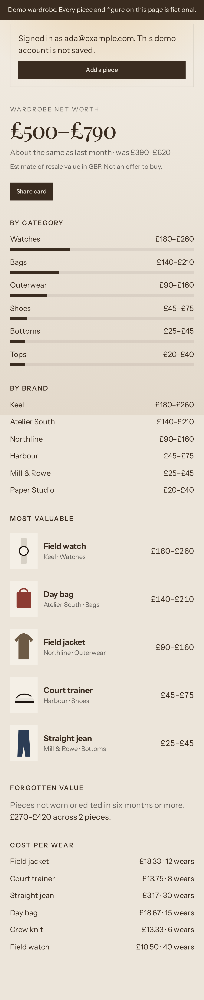
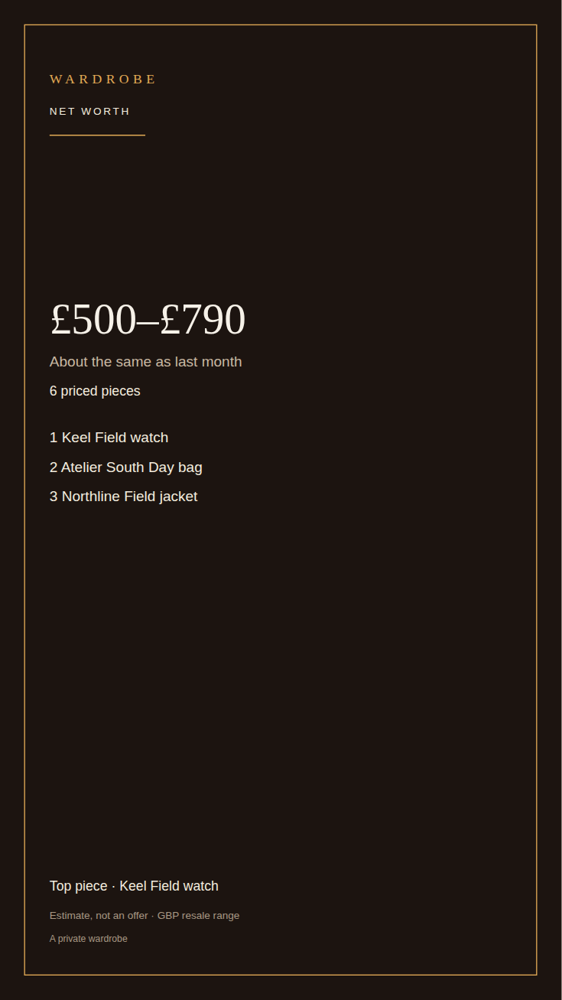
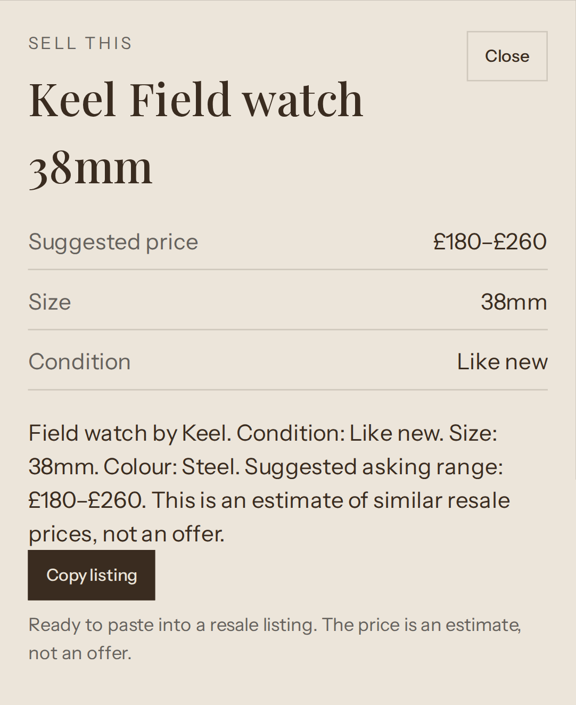

# Wardrobe

Wardrobe is a private wardrobe for people who buy and resell clothes. Photograph a piece, keep the cut-out, and see what the wardrobe is worth **today, in pounds, on the resale market**. The total is a range. It is an estimate, not an offer and not a price anyone has agreed to pay.

The home screen is built for a phone: a large net-worth range, how that range has moved since last month, breakdowns by category and brand, the five most valuable pieces, value that has not been worn or edited in six months, and cost per wear when a purchase price is set. From there you can save a 9:16 card for TikTok and Stories, a square card for X, or a ready-to-paste “Sell this” listing. Outfits, the wishlist and try-on stay in the app, one step off the main navigation.

A demo with clearly fictional pieces runs at `/demo` with no account and no production keys.

## Screenshots

Captured from the local demo wardrobe (every figure is made up):








## Stack

- TanStack Start (React 19, Vite, Nitro on Cloudflare Workers)
- Tailwind 4 and shadcn/Radix
- Supabase (auth, Postgres, storage, row-level security)
- Stripe for the Vault membership and AI credit wallet
- Lovable AI gateway, or a member’s own OpenAI key
- npm is the package manager. `package-lock.json` is the only lockfile.

## Run it locally

Requirements: Node.js 22.

```bash
npm ci
npm run dev
```

Open the app, or go straight to [http://127.0.0.1:5173/demo](http://127.0.0.1:5173/demo) for the fictional wardrobe. The demo does not call Supabase, Stripe or an AI provider.

```bash
npm run typecheck
npm run lint
npm test
npm run build
npm run test:e2e
```

End-to-end tests drive `/demo`: sign-up in the browser, the net-worth range, both share cards, a listing, and adding a Nike trainer so the total changes.

## Environment variables

Names only. Put secrets in the host’s secret store, never in git. The committed `.env` files hold publishable Supabase and Stripe client keys only.

| Name                              | Used for                                                                                               |
| --------------------------------- | ------------------------------------------------------------------------------------------------------ |
| `SUPABASE_URL`                    | Server Supabase URL                                                                                    |
| `SUPABASE_PUBLISHABLE_KEY`        | Server anon/publishable key                                                                            |
| `SUPABASE_SERVICE_ROLE_KEY`       | Server-only admin key. Never expose it to the browser.                                                 |
| `VITE_SUPABASE_URL`               | Browser Supabase URL                                                                                   |
| `VITE_SUPABASE_PUBLISHABLE_KEY`   | Browser publishable key                                                                                |
| `SUPABASE_PROJECT_ID`             | Project reference used by tooling                                                                      |
| `LOVABLE_API_KEY`                 | Built-in AI gateway                                                                                    |
| `AI_KEY_ENCRYPTION_SECRET`        | AES-GCM key for saved member API keys. At least 16 characters. Required before a new key can be saved. |
| `STRIPE_SANDBOX_API_KEY`          | Stripe test secret                                                                                     |
| `STRIPE_LIVE_API_KEY`             | Stripe live secret                                                                                     |
| `PAYMENTS_SANDBOX_WEBHOOK_SECRET` | Stripe test webhook signing                                                                            |
| `PAYMENTS_LIVE_WEBHOOK_SECRET`    | Stripe live webhook signing                                                                            |
| `VITE_PAYMENTS_CLIENT_TOKEN`      | Stripe publishable key in the browser                                                                  |
| `TRIAL_COOKIE_SECRET`             | HMAC for the no-login trial cookie. Required in production.                                            |
| `TURNSTILE_SECRET_KEY`            | Optional Cloudflare Turnstile secret. If unset, the check is skipped.                                  |
| `VITE_TURNSTILE_SITE_KEY`         | Optional Turnstile site key for the trial page.                                                        |

## Deploy

The production target is Cloudflare Workers via Nitro (`npm run build`, then the existing Lovable/Cloudflare deploy). Apply database changes **with** the app release, not after it:

```bash
supabase db push
```

or paste `supabase/migrations/20261019120000_lock_profiles_wallet_and_valuation.sql` into the Supabase SQL editor. That migration:

- stops a signed-in member updating `is_founder`, `ai_mode`, `ai_key_hint`, `email` or `id` on their profile
- revokes client writes to stored AI keys (the server writes them with the service role)
- adds `refund_ai_wallet`, so a refund and its ledger row commit together
- adds garment valuation columns, daily trial cost, and `value_snapshots`
- expires the founder invite that was seeded in an earlier migration

Set `AI_KEY_ENCRYPTION_SECRET` and `TRIAL_COOKIE_SECRET` before the new app serves traffic. Existing plaintext API keys are rewritten in encrypted form the next time they are read, once the encryption secret is set. Do not rotate that secret without a planned re-encryption; old ciphertext will not decrypt.

This repository does not deploy from CI, and this change set was not applied to the production Supabase project or Stripe account.

## Privacy

The privacy notice is served at `/privacy`. It covers UK GDPR for account data, garment photos and AI processing. Signed-in members can download a JSON copy of their wardrobe from the profile menu, and can delete the account from the same menu by typing DELETE.

## Credits and licence

Copyright (c) 2026 Danny Barr. Released under the MIT licence in [`LICENSE`](LICENSE).

Wardrobe Vaulted is a multi-user rebuild of [tandpfun/wardrobe](https://github.com/tandpfun/wardrobe), which is also MIT-licensed. The upstream copyright notice is preserved in `LICENSE`. The original `legacy/` tree has been removed now that the notice lives at the repository root.

## Lovable

The Vite config still uses `@lovable.dev/vite-tanstack-config`, so the project can keep syncing with Lovable. Two choices will show up there:

- npm replaced bun. `bun.lock` and `bunfig.toml` are gone. If Lovable recreates a bun lockfile, do not commit it alongside `package-lock.json`.
- `src/routeTree.gen.ts` is generated. Leave it for the TanStack plugin to rewrite.

Security fixes in this tree (profile column lock, encrypted keys, trial cookie, SSRF checks) are intentional. Do not revert them to match an older Lovable preview.
